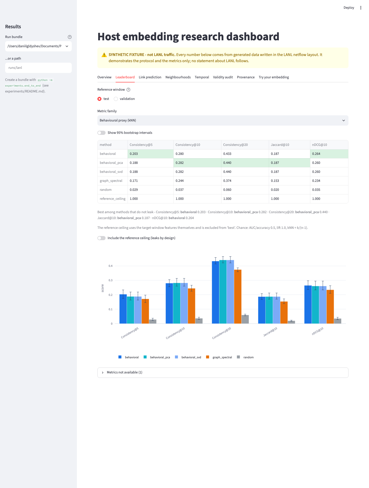
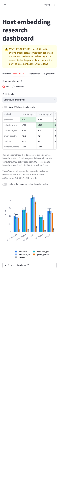
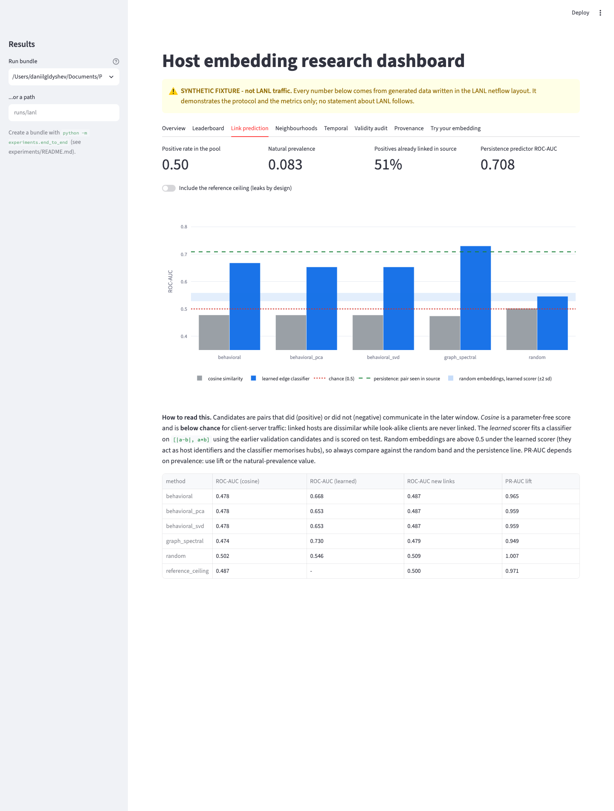
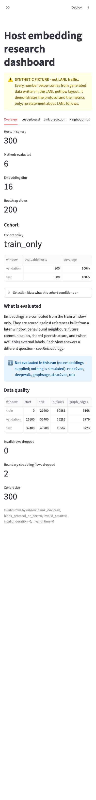
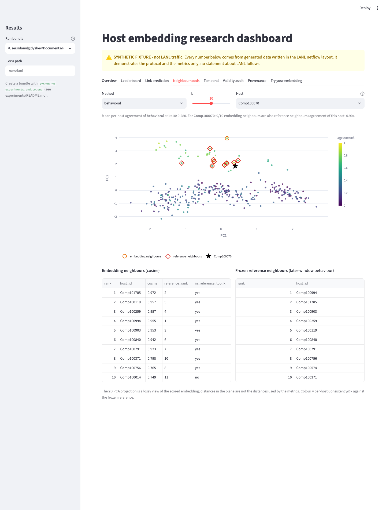

# Research dashboard (Streamlit)

Shows a **verified run bundle** (the output of `python -m experiments.end_to_end`) and lets you score your
own embeddings file. Nothing is recomputed for the headline numbers: they are read from the saved result
files, so the dashboard cannot disagree with the evaluator.

## Run

```bash
pip install -r app/requirements.txt
streamlit run app/streamlit_app.py                 # opens the committed synthetic demo bundle
PT_RESULTS_DIR=runs/lanl streamlit run app/streamlit_app.py   # or pick a bundle in the sidebar
```

Bundles are discovered in `demo/synthetic_run` and `runs/<name>`; any path can be typed in the sidebar.
The bundle shipped in the repo is **synthetic** (generated by `python -m experiments.make_demo_bundle`) and
the dashboard says so at the top of every page; real runs are labelled `LANL`.

## Tabs

| tab | content |
|---|---|
| Overview | cohort, methods, methods **not** evaluated, window sizes, invalid/dropped rows |
| Leaderboard | per metric family, validation or test reference, optional 95% bootstrap intervals, bar chart, unavailable metrics |
| Link prediction | cosine vs learned scorer, persistence line, random-embedding band, prevalence and "already linked" share |
| Neighbourhoods | 2D PCA projection coloured by per-host agreement with the frozen reference; pick a host to compare its embedding neighbours with the reference neighbours |
| Temporal | validation vs test, identity retrieval (raw vs Procrustes), drift of behavioural neighbourhoods |
| Validity audit | chance bands, feature-weight sensitivity, information shared by construction |
| Provenance | run manifest, reference manifests, file hashes, judgment rules |
| Try your embedding | upload `embeddings.csv` for the small synthetic demo cohort and compare with baselines |

## Browser verification

`python -m app.browser_check --out app/screenshots --stress` (needs `pip install playwright && playwright install chromium`)
starts the real server and drives every tab at desktop (1440 px) and phone (390 px) width in headless Chromium. It
records console errors and Streamlit exception boxes, checks horizontal overflow and `nan`/`undefined` text, and
compares what the page shows with the saved result files (best non-leaking Consistency@10 on the leaderboard,
mean per-host agreement on the Neighbourhoods tab). `--stress` repeats it on a bundle with a very long method name and
on one with the audit, embeddings, identity, validation results and neighbours removed. The last run is in
`app/screenshots/browser_check.json` (Chromium 153, Playwright 1.63, Streamlit 1.65); it is not part of CI because it
needs a browser download - the AppTests in `test_app.py` run in CI.

| desktop | phone |
|---|---|
|  |  |
|  |  |
|  | |

## Design rules

- synthetic vs real is always visible; metrics that were not computed show as unavailable, never as 0;
- the reference ceiling is marked as leaking and excluded from the "best" highlight;
- every chart shows chance (dashed) where one exists; the leaking reference ceiling is hidden from charts unless toggled on;
- missing values read `-` (never `None`/`nan`); missing artifacts give a message instead of an error.

## Layout and tests

`results.py` (data layer, no Streamlit), `views.py` (tabs), `streamlit_app.py` (layout), `core.py`
(upload flow). `python -m pytest -q app` tests the data layer against the demo bundle and renders every tab
with Streamlit's `AppTest`.
