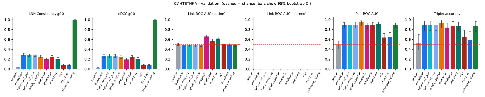
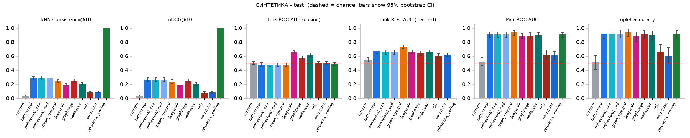
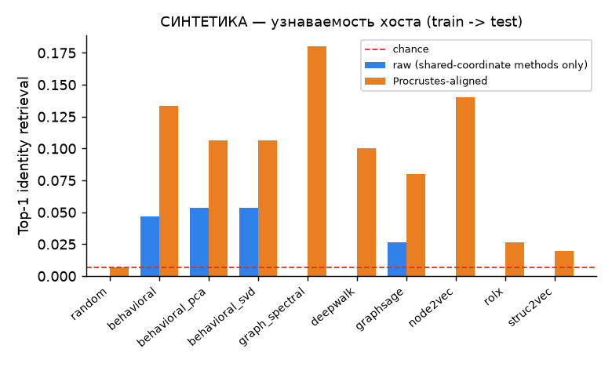
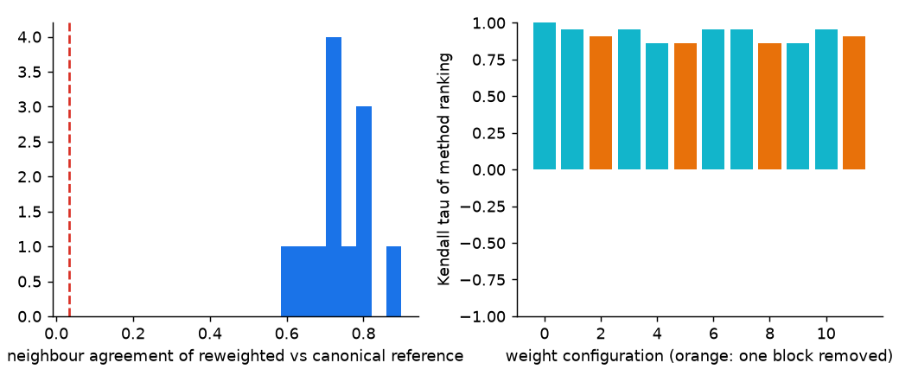

# Отчёт о прогоне

> **СИНТЕТИКА (synthetic_fixture) — не трафик LANL.**
>
> Числа получены на сгенерированных данных в формате LANL NetFlow. Они показывают работу конвейера и метрик и ничего не говорят о реальной сети.

* данные: `synthetic_fixture` (основание: marker_file); хостов в когорте: **300**; dim=16, seed=0, bootstrap=200; окна оценки: validation, test
* оценены методы: behavioral, behavioral_pca, behavioral_svd, deepwalk, graph_spectral, graphsage, node2vec, random, reference_ceiling, rolx, struc2vec
* **в этом прогоне нет** (эмбеддинги не переданы, ничего не симулируется): нет
* политика когорты `train_only`; оцениваемых хостов по окнам: validation: 300/300 (100%), test: 300/300 (100%)
  * Когорта определяется ТОЛЬКО по train-окну. Хост, неактивный в позднем окне, там не оценивается; каждый эталон строится по оцениваемым хостам, покрытие пишется в отчёт. «Выживание» хостов в поздние окна — часть измеряемого результата, а не определения когорты.

## Результаты — эталон validation

| method | consistency@10_mean | ndcg@10_mean | link_roc_auc | link_learned_roc_auc | link_new_roc_auc | partner_new_mrr | pair_roc_auc | triplet_accuracy | precision@3 | recall@3 |
|---|---|---|---|---|---|---|---|---|---|---|
| random | 0.032 | 0.026 | 0.501 | n/a | 0.509 | 0.144 | 0.481 | 0.528 | 0.331 | 0.540 |
| behavioral | 0.284 | 0.263 | 0.477 | n/a | 0.480 | 0.159 | 0.893 | 0.896 | 0.529 | 0.875 |
| behavioral_pca | 0.279 | 0.265 | 0.477 | n/a | 0.480 | 0.158 | 0.897 | 0.896 | 0.531 | 0.877 |
| behavioral_svd | 0.279 | 0.265 | 0.477 | n/a | 0.480 | 0.158 | 0.897 | 0.896 | 0.531 | 0.877 |
| graph_spectral | 0.253 | 0.237 | 0.479 | n/a | 0.484 | 0.155 | 0.945 | 0.937 | 0.553 | 0.911 |
| deepwalk | 0.197 | 0.194 | 0.659 | n/a | 0.504 | 0.153 | 0.886 | 0.840 | 0.509 | 0.845 |
| graphsage | 0.245 | 0.237 | 0.574 | n/a | 0.491 | 0.157 | 0.883 | 0.874 | 0.519 | 0.851 |
| node2vec | 0.210 | 0.206 | 0.618 | n/a | 0.490 | 0.158 | 0.905 | 0.877 | 0.537 | 0.890 |
| rolx | 0.078 | 0.075 | 0.501 | n/a | 0.505 | 0.154 | 0.636 | 0.647 | 0.387 | 0.624 |
| struc2vec | 0.080 | 0.075 | 0.492 | n/a | 0.494 | 0.144 | 0.644 | 0.584 | 0.381 | 0.620 |
| reference_ceiling | 1.000 | 1.000 | 0.476 | n/a | 0.485 | 0.160 | 0.887 | 0.874 | 0.533 | 0.892 |

Точка отсчёта для связей без эмбеддинга — *пара уже общалась в source-окне*: ROC-AUC **0.710**. `link_learned_*` — классификатор рёбер, обученный на кандидатах validation и оценённый на test; косинус показан для полноты.

## Результаты — эталон test

| method | consistency@10_mean | ndcg@10_mean | link_roc_auc | link_learned_roc_auc | link_new_roc_auc | partner_new_mrr | pair_roc_auc | triplet_accuracy | precision@3 | recall@3 |
|---|---|---|---|---|---|---|---|---|---|---|
| random | 0.037 | 0.035 | 0.502 | 0.546 | 0.509 | 0.164 | 0.516 | 0.514 | 0.232 | 0.268 |
| behavioral | 0.280 | 0.264 | 0.478 | 0.668 | 0.487 | 0.169 | 0.907 | 0.918 | 0.591 | 0.745 |
| behavioral_pca | 0.282 | 0.260 | 0.478 | 0.653 | 0.487 | 0.165 | 0.908 | 0.920 | 0.599 | 0.758 |
| behavioral_svd | 0.282 | 0.260 | 0.478 | 0.653 | 0.487 | 0.165 | 0.908 | 0.920 | 0.599 | 0.758 |
| graph_spectral | 0.244 | 0.234 | 0.474 | 0.730 | 0.479 | 0.174 | 0.938 | 0.940 | 0.623 | 0.805 |
| deepwalk | 0.187 | 0.193 | 0.652 | 0.660 | 0.492 | 0.170 | 0.887 | 0.884 | 0.553 | 0.704 |
| graphsage | 0.245 | 0.239 | 0.568 | 0.640 | 0.480 | 0.176 | 0.890 | 0.912 | 0.573 | 0.722 |
| node2vec | 0.206 | 0.203 | 0.619 | 0.659 | 0.490 | 0.179 | 0.900 | 0.897 | 0.572 | 0.729 |
| rolx | 0.081 | 0.078 | 0.497 | 0.605 | 0.501 | 0.146 | 0.616 | 0.657 | 0.292 | 0.336 |
| struc2vec | 0.089 | 0.081 | 0.493 | 0.621 | 0.499 | 0.150 | 0.607 | 0.605 | 0.270 | 0.263 |
| reference_ceiling | 1.000 | 1.000 | 0.487 | n/a | 0.500 | 0.176 | 0.905 | 0.914 | 0.580 | 0.720 |

Точка отсчёта для связей без эмбеддинга — *пара уже общалась в source-окне*: ROC-AUC **0.708**. `link_learned_*` — классификатор рёбер, обученный на кандидатах validation и оценённый на test; косинус показан для полноты.

## Недоступные метрики

* linear_probe: нет labels.csv (внешних меток хостов нет, придумывать их нельзя)

## 95% бутстреп-интервалы (test)

| method | metric | estimate | ci_low | ci_high |
|---|---|---|---|---|
| random | consistency@10_mean | 0.037 | 0.030 | 0.044 |
| random | link_roc_auc | 0.502 | 0.482 | 0.523 |
| random | pair_roc_auc | 0.516 | 0.463 | 0.576 |
| random | triplet_accuracy | 0.514 | 0.410 | 0.606 |
| behavioral | consistency@10_mean | 0.280 | 0.256 | 0.304 |
| behavioral | link_roc_auc | 0.478 | 0.451 | 0.506 |
| behavioral | pair_roc_auc | 0.907 | 0.866 | 0.944 |
| behavioral | triplet_accuracy | 0.918 | 0.851 | 0.967 |
| behavioral_pca | consistency@10_mean | 0.282 | 0.260 | 0.313 |
| behavioral_pca | link_roc_auc | 0.478 | 0.450 | 0.505 |
| behavioral_pca | pair_roc_auc | 0.908 | 0.866 | 0.945 |
| behavioral_pca | triplet_accuracy | 0.920 | 0.857 | 0.968 |
| behavioral_svd | consistency@10_mean | 0.282 | 0.260 | 0.313 |
| behavioral_svd | link_roc_auc | 0.478 | 0.450 | 0.505 |
| behavioral_svd | pair_roc_auc | 0.908 | 0.866 | 0.945 |
| behavioral_svd | triplet_accuracy | 0.920 | 0.857 | 0.968 |
| graph_spectral | consistency@10_mean | 0.244 | 0.225 | 0.266 |
| graph_spectral | link_roc_auc | 0.474 | 0.448 | 0.498 |
| graph_spectral | pair_roc_auc | 0.938 | 0.894 | 0.966 |
| graph_spectral | triplet_accuracy | 0.940 | 0.879 | 0.980 |
| deepwalk | consistency@10_mean | 0.187 | 0.171 | 0.207 |
| deepwalk | link_roc_auc | 0.652 | 0.630 | 0.677 |
| deepwalk | pair_roc_auc | 0.887 | 0.846 | 0.925 |
| deepwalk | triplet_accuracy | 0.884 | 0.805 | 0.946 |
| graphsage | consistency@10_mean | 0.245 | 0.222 | 0.272 |
| graphsage | link_roc_auc | 0.568 | 0.542 | 0.598 |
| graphsage | pair_roc_auc | 0.890 | 0.845 | 0.930 |
| graphsage | triplet_accuracy | 0.912 | 0.853 | 0.959 |
| node2vec | consistency@10_mean | 0.206 | 0.191 | 0.225 |
| node2vec | link_roc_auc | 0.619 | 0.597 | 0.642 |
| node2vec | pair_roc_auc | 0.900 | 0.857 | 0.933 |
| node2vec | triplet_accuracy | 0.897 | 0.813 | 0.957 |
| rolx | consistency@10_mean | 0.081 | 0.069 | 0.096 |
| rolx | link_roc_auc | 0.497 | 0.472 | 0.520 |
| rolx | pair_roc_auc | 0.616 | 0.555 | 0.682 |
| rolx | triplet_accuracy | 0.657 | 0.540 | 0.766 |
| struc2vec | consistency@10_mean | 0.089 | 0.077 | 0.106 |
| struc2vec | link_roc_auc | 0.493 | 0.470 | 0.518 |
| struc2vec | pair_roc_auc | 0.607 | 0.541 | 0.665 |
| struc2vec | triplet_accuracy | 0.605 | 0.500 | 0.717 |
| reference_ceiling | consistency@10_mean | 1.000 | 1.000 | 1.000 |
| reference_ceiling | link_roc_auc | 0.487 | 0.462 | 0.512 |
| reference_ceiling | pair_roc_auc | 0.905 | 0.859 | 0.936 |
| reference_ceiling | triplet_accuracy | 0.914 | 0.852 | 0.966 |

## Узнаваемость хоста во времени (train -> test)

| method | общие координаты заявлены | Top-1 сырые | Top-1 Procrustes | MRR Procrustes | ROC-AUC пар Procrustes | случайный Top-1 |
|---|---|---|---|---|---|---|
| random | False | 0.000 | 0.007 | 0.035 | 0.523 | 0.007 |
| behavioral | True | 0.047 | 0.133 | 0.262 | 0.911 | 0.007 |
| behavioral_pca | True | 0.053 | 0.107 | 0.252 | 0.892 | 0.007 |
| behavioral_svd | True | 0.053 | 0.107 | 0.252 | 0.892 | 0.007 |
| graph_spectral | False | 0.000 | 0.180 | 0.324 | 0.936 | 0.007 |
| deepwalk | False | 0.027 | 0.100 | 0.251 | 0.909 | 0.007 |
| graphsage | True | 0.027 | 0.080 | 0.206 | 0.911 | 0.007 |
| node2vec | False | 0.093 | 0.140 | 0.285 | 0.899 | 0.007 |
| rolx | False | 0.013 | 0.027 | 0.079 | 0.648 | 0.007 |
| struc2vec | False | 0.020 | 0.020 | 0.064 | 0.570 | 0.007 |

Сырые координаты осмысленны только для методов, заявивших общую систему координат.

## Аудит валидности

* **Чувствительность к весам** (12 изменённых поведенческих эталонов, k=10): совпадение соседей с основным эталоном в среднем 0.74 (минимум 0.58; случайно 0.033); тау Кендалла порядка методов в среднем 0.92, минимум 0.86.
* **Стабильность эталона** train->validation: Consistency@10 = 0.28 (случайно 0.033) — поведенческое соседство дрейфует между окнами.
* **Стабильность эталона** train->test: Consistency@10 = 0.28 (случайно 0.033) — поведенческое соседство дрейфует между окнами.
* **Стабильность эталона** validation->test: Consistency@10 = 0.33 (случайно 0.033) — поведенческое соседство дрейфует между окнами.
* **Согласие порядка validation и test** (тау Кендалла): consistency@10_mean: 0.89, link_roc_auc: 0.70, pair_roc_auc: 0.78, triplet_accuracy: 0.90
* **Случайный уровень (случайные эмбеддинги, test)**: consistency@10_mean 0.034 ± 0.003, link_roc_auc 0.501 ± 0.007, link_learned_roc_auc 0.543 ± 0.007, pair_roc_auc 0.501 ± 0.021, triplet_accuracy 0.502 ± 0.023
* **Доля связей среди кандидатов**: в выборке 0.50, на самом деле 0.083; 51% будущих связей уже были в source-окне (см. ROC-AUC только новых связей).

### Что метод делит с эталоном по построению

| method | neighbors | edges | pairs |
|---|---|---|---|
| random | none | none | none |
| behavioral | same feature definitions, earlier window (feature overlap) | none | weak: behaviour correlates with peers |
| behavioral_pca | same feature definitions, earlier window (feature overlap) | none | weak: behaviour correlates with peers |
| behavioral_svd | same feature definitions, earlier window (feature overlap) | none | weak: behaviour correlates with peers |
| behavioral_portfree | same feature definitions MINUS the port block, earlier window (reduced feature overlap) | none | weak: behaviour correlates with peers |
| behavioral_portfree_pca | same feature definitions MINUS the port block, earlier window (reduced feature overlap) | none | weak: behaviour correlates with peers |
| graph_spectral | weak: degree/volume leaks into the spectrum | strong: link persistence (peers seen in train recur) | strong: peer sets persist across windows |
| reference_ceiling | identical by construction (target-window features) | none | weak |
| deepwalk | weak: peers/degree structure correlates with behaviour | strong: link persistence (peers seen in train recur) | strong: shared peers = shared neighbourhood |
| graphsage | strong with features='behavioral': same feature definitions as the behavioural reference | strong: link persistence through the neighbourhood aggregation | strong: shared peers = shared neighbourhood |
| node2vec | weak: peers/degree structure correlates with behaviour | strong: link persistence (peers seen in train recur) | strong: shared peers = shared neighbourhood |
| rolx | weak: degree/volume-like structure correlates with behaviour | weak: structural roles, not specific peers, so link persistence is not encoded | weak: shared peers are not encoded (roles ignore identity) |
| struc2vec | weak: degree structure correlates with behaviour | weak: structural identity, not specific peers, so link persistence is not encoded | weak: shared peers are not encoded (structure ignores identity) |

## Как читать эти числа

* **Прогноз:** будущие связи (результат виден позже) и узнаваемость. **Согласие с выбранным нами приближением:** kNN (поведенческий профиль), пары/тройки/P@k (общие собеседники).
* `reference_ceiling` — признаки самого целевого окна, «утекает» намеренно; бейзлайны делят с эталонами признаки или структуру собеседников (таблица выше), поэтому это точки калибровки, а не независимое доказательство.
* Интервалы: для kNN и Precision@k пересэмплируются хосты; для связей, пар и троек — бутстреп по хостам (пары делят хостов). Они описывают только выбор оцениваемых элементов, а не seed модели, эталон или окна.
* Данные синтетические, поэтому о LANL ни одно число выше ничего не говорит.
