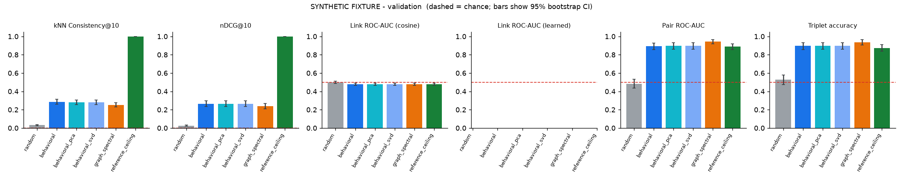
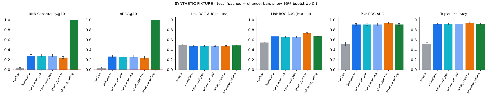
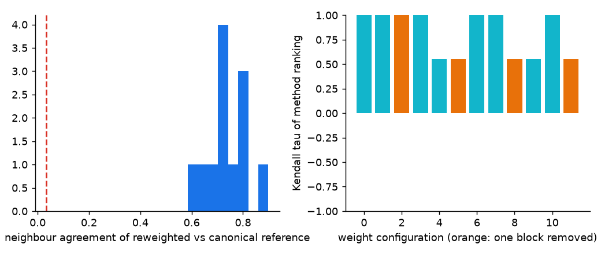

# Benchmark run report

> **SYNTHETIC FIXTURE - not LANL traffic.** Numbers demonstrate the pipeline and the metrics only; they say nothing about real network behaviour.

* hosts in cohort: **300**; dim=16, seed=0, bootstrap=200; targets: validation, test
* methods evaluated: behavioral, behavioral_pca, behavioral_svd, graph_spectral, random, reference_ceiling
* **not available in this run** (no embeddings supplied, nothing simulated): node2vec, deepwalk, graphsage, struc2vec, rolx

## Scores - validation reference

| method | consistency@10_mean | ndcg@10_mean | link_roc_auc | link_learned_roc_auc | link_new_roc_auc | pair_roc_auc | triplet_accuracy | precision@3 | recall@3 |
|---|---|---|---|---|---|---|---|---|---|
| random | 0.032 | 0.026 | 0.501 | n/a | 0.509 | 0.481 | 0.528 | 0.331 | 0.540 |
| behavioral | 0.284 | 0.263 | 0.477 | n/a | 0.480 | 0.893 | 0.896 | 0.529 | 0.875 |
| behavioral_pca | 0.279 | 0.265 | 0.477 | n/a | 0.480 | 0.897 | 0.896 | 0.531 | 0.877 |
| behavioral_svd | 0.279 | 0.265 | 0.477 | n/a | 0.480 | 0.897 | 0.896 | 0.531 | 0.877 |
| graph_spectral | 0.253 | 0.237 | 0.479 | n/a | 0.484 | 0.945 | 0.937 | 0.553 | 0.911 |
| reference_ceiling | 1.000 | 1.000 | 0.476 | n/a | 0.485 | 0.887 | 0.874 | 0.533 | 0.892 |

Link-prediction reference point (no embedding): *pair already seen in the source window* scores ROC-AUC **0.710**. `link_learned_*` fits an edge classifier on the validation candidates and scores the test candidates; cosine is shown for completeness.

## Scores - test reference

| method | consistency@10_mean | ndcg@10_mean | link_roc_auc | link_learned_roc_auc | link_new_roc_auc | pair_roc_auc | triplet_accuracy | precision@3 | recall@3 |
|---|---|---|---|---|---|---|---|---|---|
| random | 0.037 | 0.035 | 0.502 | 0.546 | 0.509 | 0.516 | 0.514 | 0.232 | 0.268 |
| behavioral | 0.280 | 0.264 | 0.478 | 0.668 | 0.487 | 0.907 | 0.918 | 0.591 | 0.745 |
| behavioral_pca | 0.282 | 0.260 | 0.478 | 0.653 | 0.487 | 0.908 | 0.920 | 0.599 | 0.758 |
| behavioral_svd | 0.282 | 0.260 | 0.478 | 0.653 | 0.487 | 0.908 | 0.920 | 0.599 | 0.758 |
| graph_spectral | 0.244 | 0.234 | 0.474 | 0.730 | 0.479 | 0.938 | 0.940 | 0.623 | 0.805 |
| reference_ceiling | 1.000 | 1.000 | 0.487 | 0.681 | 0.500 | 0.905 | 0.914 | 0.580 | 0.720 |

Link-prediction reference point (no embedding): *pair already seen in the source window* scores ROC-AUC **0.708**. `link_learned_*` fits an edge classifier on the validation candidates and scores the test candidates; cosine is shown for completeness.

## Metrics not available

* linear_probe: labels.csv missing (no external host labels exist; none are fabricated)

## 95% bootstrap intervals (test)

| method | metric | estimate | ci_low | ci_high |
|---|---|---|---|---|
| random | consistency@10_mean | 0.037 | 0.030 | 0.044 |
| random | link_roc_auc | 0.502 | 0.490 | 0.516 |
| random | pair_roc_auc | 0.516 | 0.486 | 0.547 |
| random | triplet_accuracy | 0.514 | 0.480 | 0.548 |
| behavioral | consistency@10_mean | 0.280 | 0.256 | 0.304 |
| behavioral | link_roc_auc | 0.478 | 0.464 | 0.491 |
| behavioral | pair_roc_auc | 0.907 | 0.888 | 0.929 |
| behavioral | triplet_accuracy | 0.918 | 0.896 | 0.940 |
| behavioral_pca | consistency@10_mean | 0.282 | 0.260 | 0.313 |
| behavioral_pca | link_roc_auc | 0.478 | 0.464 | 0.491 |
| behavioral_pca | pair_roc_auc | 0.908 | 0.889 | 0.930 |
| behavioral_pca | triplet_accuracy | 0.920 | 0.896 | 0.941 |
| behavioral_svd | consistency@10_mean | 0.282 | 0.260 | 0.313 |
| behavioral_svd | link_roc_auc | 0.478 | 0.464 | 0.491 |
| behavioral_svd | pair_roc_auc | 0.908 | 0.889 | 0.930 |
| behavioral_svd | triplet_accuracy | 0.920 | 0.896 | 0.941 |
| graph_spectral | consistency@10_mean | 0.244 | 0.225 | 0.266 |
| graph_spectral | link_roc_auc | 0.474 | 0.462 | 0.487 |
| graph_spectral | pair_roc_auc | 0.938 | 0.918 | 0.957 |
| graph_spectral | triplet_accuracy | 0.940 | 0.920 | 0.959 |
| reference_ceiling | consistency@10_mean | 1.000 | 1.000 | 1.000 |
| reference_ceiling | link_roc_auc | 0.487 | 0.475 | 0.500 |
| reference_ceiling | pair_roc_auc | 0.905 | 0.884 | 0.926 |
| reference_ceiling | triplet_accuracy | 0.914 | 0.892 | 0.935 |

## Identity retrieval (train -> test)

| method | shared coords declared | Top-1 raw | Top-1 Procrustes | MRR Procrustes | chance Top-1 |
|---|---|---|---|---|---|
| random | False | 0.000 | 0.007 | 0.035 | 0.007 |
| behavioral | True | 0.047 | 0.133 | 0.262 | 0.007 |
| behavioral_pca | True | 0.053 | 0.107 | 0.252 | 0.007 |
| behavioral_svd | True | 0.053 | 0.107 | 0.252 | 0.007 |
| graph_spectral | False | 0.000 | 0.180 | 0.324 | 0.007 |

Raw-coordinate scores are only interpretable for methods that declare a shared coordinate system.

## Validity audit

* **Weight sensitivity** (12 perturbed behavioural references, k=10): neighbour agreement with the canonical reference 0.74 on average (min 0.58; chance 0.033); method-ranking Kendall tau mean 0.81, min 0.56.
* **Reference stability** train->validation: Consistency@10 = 0.28 (chance 0.033) - behavioural neighbourhoods drift between windows.
* **Reference stability** train->test: Consistency@10 = 0.28 (chance 0.033) - behavioural neighbourhoods drift between windows.
* **Reference stability** validation->test: Consistency@10 = 0.33 (chance 0.033) - behavioural neighbourhoods drift between windows.
* **Validation vs test ranking agreement** (Kendall tau): consistency@10_mean: 0.71, link_roc_auc: 0.00, pair_roc_auc: 1.00, triplet_accuracy: 0.93
* **Chance band (random embeddings, test reference)**: consistency@10_mean 0.034 ± 0.003, link_roc_auc 0.501 ± 0.007, link_learned_roc_auc 0.543 ± 0.007, pair_roc_auc 0.501 ± 0.021, triplet_accuracy 0.502 ± 0.023
* **Link-prediction prevalence**: sampled positive rate 0.50 vs natural 0.083; 51% of positive links were already present in the source window (compare 'New-link ROC-AUC').

### Information shared by construction (method input vs reference source)

| method | neighbors | edges | pairs |
|---|---|---|---|
| random | none | none | none |
| behavioral | same feature definitions, earlier window (feature overlap) | none | weak: behaviour correlates with peers |
| behavioral_pca | same feature definitions, earlier window (feature overlap) | none | weak: behaviour correlates with peers |
| behavioral_svd | same feature definitions, earlier window (feature overlap) | none | weak: behaviour correlates with peers |
| graph_spectral | weak: degree/volume leaks into the spectrum | strong: link persistence (peers seen in train recur) | strong: peer sets persist across windows |
| reference_ceiling | identical by construction (target-window features) | none | weak |

## Reading these numbers

* **Predictive:** future links (outcome observed later) and identity stability. **Agreement with a proxy we chose:** kNN consistency (behavioural profile), pair/triplet/P@k (shared peers).
* `reference_ceiling` uses the target-window features themselves and leaks by design; baselines share feature definitions or peer structure with the references (table above), so they are calibration points, not independent evidence.
* Intervals cover evaluation-set sampling only, not model seeds or reference choice.
