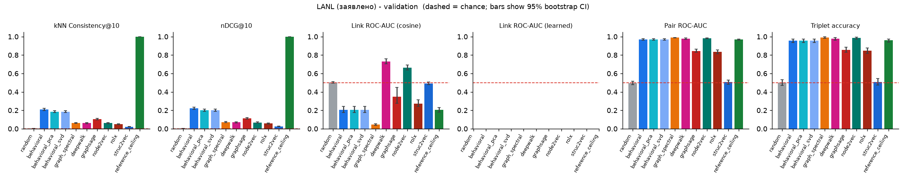
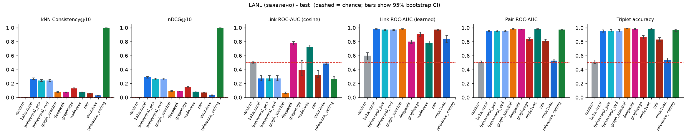
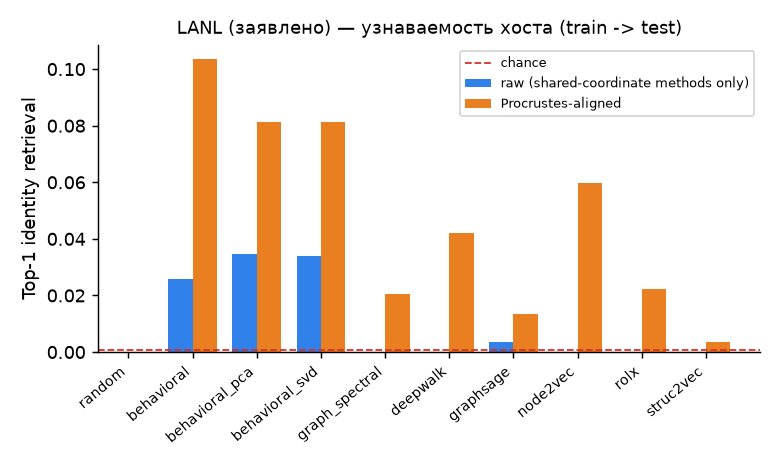
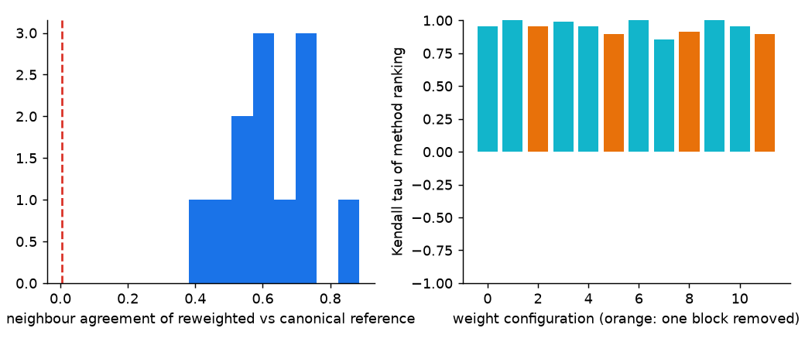

# Отчёт о прогоне

> **LANL (заявлено оператором; происхождение пайплайном не проверено).**
>
> Выводы относятся к заявленным файлам LANL NetFlow при протоколе из этого отчёта (окна, когорта, эталоны). Это не утверждения о других данных, других окнах или ролях хостов.

* источник, заявленный оператором: *csr.lanl.gov/data/2017 form, 2026-10-17, physcorgi*. Пайплайн проверить это не может (`provenance_verified: false`).
* данные: `lanl_declared` (основание: operator_declaration); хостов в когорте: **6453**; dim=16, seed=0, bootstrap=200; окна оценки: validation, test
* оценены методы: behavioral, behavioral_pca, behavioral_svd, deepwalk, graph_spectral, graphsage, node2vec, random, reference_ceiling, rolx, struc2vec
* **в этом прогоне нет** (эмбеддинги не переданы, ничего не симулируется): нет
* политика когорты `train_only`; оцениваемых хостов по окнам: validation: 2761/6453 (43%), test: 2242/6453 (35%)
  * The cohort is defined from the TRAIN window only. Hosts that are inactive in a later window are not evaluable there; every reference is built on the evaluable hosts and the coverage is reported. Survivorship of hosts into later windows is therefore part of the measured outcome, not of the cohort definition.

## Результаты — эталон validation

| method | consistency@10_mean | ndcg@10_mean | link_roc_auc | link_learned_roc_auc | link_new_roc_auc | partner_new_mrr | pair_roc_auc | triplet_accuracy | precision@3 | recall@3 |
|---|---|---|---|---|---|---|---|---|---|---|
| random | 0.004 | 0.003 | 0.502 | n/a | 0.495 | 0.081 | 0.493 | 0.500 | 0.516 | 0.425 |
| behavioral | 0.208 | 0.222 | 0.206 | n/a | 0.150 | 0.225 | 0.968 | 0.956 | 0.820 | 0.697 |
| behavioral_pca | 0.185 | 0.201 | 0.207 | n/a | 0.149 | 0.220 | 0.968 | 0.957 | 0.821 | 0.699 |
| behavioral_svd | 0.185 | 0.201 | 0.207 | n/a | 0.149 | 0.219 | 0.968 | 0.957 | 0.821 | 0.699 |
| graph_spectral | 0.062 | 0.071 | 0.043 | n/a | 0.043 | 0.211 | 0.988 | 0.991 | 0.846 | 0.721 |
| deepwalk | 0.061 | 0.071 | 0.731 | n/a | 0.611 | 0.228 | 0.977 | 0.978 | 0.833 | 0.711 |
| graphsage | 0.103 | 0.112 | 0.348 | n/a | 0.458 | 0.202 | 0.845 | 0.856 | 0.764 | 0.642 |
| node2vec | 0.060 | 0.067 | 0.663 | n/a | 0.497 | 0.234 | 0.981 | 0.985 | 0.841 | 0.717 |
| rolx | 0.048 | 0.056 | 0.273 | n/a | 0.273 | 0.182 | 0.835 | 0.848 | 0.765 | 0.642 |
| struc2vec | 0.021 | 0.026 | 0.492 | n/a | 0.490 | 0.128 | 0.507 | 0.507 | 0.544 | 0.450 |
| reference_ceiling | 1.000 | 1.000 | 0.204 | n/a | 0.158 | 0.251 | 0.969 | 0.959 | 0.824 | 0.700 |

Точка отсчёта для связей без эмбеддинга — *пара уже общалась в source-окне*: ROC-AUC **0.946**. `link_learned_*` — классификатор рёбер, обученный на кандидатах validation и оценённый на test; косинус показан для полноты.

## Результаты — эталон test

| method | consistency@10_mean | ndcg@10_mean | link_roc_auc | link_learned_roc_auc | link_new_roc_auc | partner_new_mrr | pair_roc_auc | triplet_accuracy | precision@3 | recall@3 |
|---|---|---|---|---|---|---|---|---|---|---|
| random | 0.004 | 0.004 | 0.502 | 0.598 | 0.487 | 0.063 | 0.511 | 0.512 | 0.480 | 0.215 |
| behavioral | 0.269 | 0.290 | 0.272 | 0.983 | 0.204 | 0.204 | 0.954 | 0.954 | 0.869 | 0.468 |
| behavioral_pca | 0.242 | 0.264 | 0.272 | 0.973 | 0.204 | 0.191 | 0.956 | 0.958 | 0.869 | 0.467 |
| behavioral_svd | 0.242 | 0.264 | 0.272 | 0.973 | 0.204 | 0.190 | 0.956 | 0.958 | 0.869 | 0.467 |
| graph_spectral | 0.077 | 0.092 | 0.064 | 0.980 | 0.062 | 0.196 | 0.984 | 0.991 | 0.898 | 0.485 |
| deepwalk | 0.075 | 0.087 | 0.777 | 0.801 | 0.652 | 0.204 | 0.977 | 0.981 | 0.892 | 0.483 |
| graphsage | 0.129 | 0.146 | 0.399 | 0.917 | 0.492 | 0.168 | 0.835 | 0.863 | 0.817 | 0.427 |
| node2vec | 0.073 | 0.085 | 0.722 | 0.776 | 0.561 | 0.215 | 0.981 | 0.986 | 0.896 | 0.485 |
| rolx | 0.059 | 0.071 | 0.326 | 0.971 | 0.321 | 0.168 | 0.816 | 0.833 | 0.801 | 0.408 |
| struc2vec | 0.027 | 0.032 | 0.486 | 0.842 | 0.476 | 0.104 | 0.530 | 0.534 | 0.515 | 0.233 |
| reference_ceiling | 1.000 | 1.000 | 0.260 | n/a | 0.211 | 0.230 | 0.973 | 0.965 | 0.876 | 0.470 |

Точка отсчёта для связей без эмбеддинга — *пара уже общалась в source-окне*: ROC-AUC **0.939**. `link_learned_*` — классификатор рёбер, обученный на кандидатах validation и оценённый на test; косинус показан для полноты.

## Недоступные метрики

* linear_probe: нет labels.csv (внешних меток хостов нет, придумывать их нельзя)

## 95% бутстреп-интервалы (test)

| method | metric | estimate | ci_low | ci_high |
|---|---|---|---|---|
| random | consistency@10_mean | 0.004 | 0.004 | 0.005 |
| random | link_roc_auc | 0.502 | 0.490 | 0.510 |
| random | pair_roc_auc | 0.511 | 0.499 | 0.524 |
| random | triplet_accuracy | 0.512 | 0.487 | 0.538 |
| behavioral | consistency@10_mean | 0.269 | 0.258 | 0.281 |
| behavioral | link_roc_auc | 0.272 | 0.240 | 0.314 |
| behavioral | pair_roc_auc | 0.954 | 0.946 | 0.962 |
| behavioral | triplet_accuracy | 0.954 | 0.937 | 0.969 |
| behavioral_pca | consistency@10_mean | 0.242 | 0.230 | 0.254 |
| behavioral_pca | link_roc_auc | 0.272 | 0.240 | 0.314 |
| behavioral_pca | pair_roc_auc | 0.956 | 0.947 | 0.964 |
| behavioral_pca | triplet_accuracy | 0.958 | 0.940 | 0.972 |
| behavioral_svd | consistency@10_mean | 0.242 | 0.230 | 0.254 |
| behavioral_svd | link_roc_auc | 0.272 | 0.240 | 0.314 |
| behavioral_svd | pair_roc_auc | 0.956 | 0.947 | 0.964 |
| behavioral_svd | triplet_accuracy | 0.958 | 0.940 | 0.972 |
| graph_spectral | consistency@10_mean | 0.077 | 0.072 | 0.082 |
| graph_spectral | link_roc_auc | 0.064 | 0.053 | 0.080 |
| graph_spectral | pair_roc_auc | 0.984 | 0.978 | 0.990 |
| graph_spectral | triplet_accuracy | 0.991 | 0.984 | 0.996 |
| deepwalk | consistency@10_mean | 0.075 | 0.069 | 0.080 |
| deepwalk | link_roc_auc | 0.777 | 0.752 | 0.803 |
| deepwalk | pair_roc_auc | 0.977 | 0.970 | 0.982 |
| deepwalk | triplet_accuracy | 0.981 | 0.974 | 0.989 |
| graphsage | consistency@10_mean | 0.129 | 0.121 | 0.137 |
| graphsage | link_roc_auc | 0.399 | 0.319 | 0.534 |
| graphsage | pair_roc_auc | 0.835 | 0.819 | 0.854 |
| graphsage | triplet_accuracy | 0.863 | 0.841 | 0.888 |
| node2vec | consistency@10_mean | 0.073 | 0.068 | 0.078 |
| node2vec | link_roc_auc | 0.722 | 0.693 | 0.750 |
| node2vec | pair_roc_auc | 0.981 | 0.977 | 0.987 |
| node2vec | triplet_accuracy | 0.986 | 0.979 | 0.993 |
| rolx | consistency@10_mean | 0.059 | 0.054 | 0.063 |
| rolx | link_roc_auc | 0.326 | 0.287 | 0.384 |
| rolx | pair_roc_auc | 0.816 | 0.792 | 0.833 |
| rolx | triplet_accuracy | 0.833 | 0.806 | 0.858 |
| struc2vec | consistency@10_mean | 0.027 | 0.024 | 0.029 |
| struc2vec | link_roc_auc | 0.486 | 0.469 | 0.503 |
| struc2vec | pair_roc_auc | 0.530 | 0.514 | 0.549 |
| struc2vec | triplet_accuracy | 0.534 | 0.502 | 0.566 |
| reference_ceiling | consistency@10_mean | 1.000 | 1.000 | 1.000 |
| reference_ceiling | link_roc_auc | 0.260 | 0.234 | 0.296 |
| reference_ceiling | pair_roc_auc | 0.973 | 0.966 | 0.979 |
| reference_ceiling | triplet_accuracy | 0.965 | 0.950 | 0.977 |

## Узнаваемость хоста во времени (train -> test)

| method | общие координаты заявлены | Top-1 сырые | Top-1 Procrustes | MRR Procrustes | ROC-AUC пар Procrustes | случайный Top-1 |
|---|---|---|---|---|---|---|
| random | False | 0.000 | 0.000 | 0.007 | 0.504 | 0.001 |
| behavioral | True | 0.026 | 0.103 | 0.169 | 0.800 | 0.001 |
| behavioral_pca | True | 0.035 | 0.081 | 0.147 | 0.838 | 0.001 |
| behavioral_svd | True | 0.034 | 0.081 | 0.147 | 0.838 | 0.001 |
| graph_spectral | False | 0.001 | 0.021 | 0.063 | 0.781 | 0.001 |
| deepwalk | False | 0.001 | 0.042 | 0.099 | 0.859 | 0.001 |
| graphsage | True | 0.004 | 0.013 | 0.050 | 0.803 | 0.001 |
| node2vec | False | 0.002 | 0.060 | 0.145 | 0.899 | 0.001 |
| rolx | False | 0.007 | 0.022 | 0.065 | 0.804 | 0.001 |
| struc2vec | False | 0.001 | 0.004 | 0.016 | 0.566 | 0.001 |

Сырые координаты осмысленны только для методов, заявивших общую систему координат.

## Аудит валидности

* **Чувствительность к весам** (12 изменённых поведенческих эталонов, k=10): совпадение соседей с основным эталоном в среднем 0.62 (минимум 0.38; случайно 0.004); тау Кендалла порядка методов в среднем 0.95, минимум 0.85.
* **Стабильность эталона** train->validation: Consistency@10 = 0.31 (случайно 0.007) — поведенческое соседство дрейфует между окнами.
* **Стабильность эталона** train->test: Consistency@10 = 0.32 (случайно 0.007) — поведенческое соседство дрейфует между окнами.
* **Стабильность эталона** validation->test: Consistency@10 = 0.32 (случайно 0.007) — поведенческое соседство дрейфует между окнами.
* **Согласие порядка validation и test** (тау Кендалла): consistency@10_mean: 0.96, link_roc_auc: 0.93, pair_roc_auc: 1.00, triplet_accuracy: 1.00
* **Случайный уровень (случайные эмбеддинги, test)**: consistency@10_mean 0.005 ± 0.001, link_roc_auc 0.500 ± 0.002, link_learned_roc_auc 0.629 ± 0.021, pair_roc_auc 0.499 ± 0.005, triplet_accuracy 0.498 ± 0.008
* **Доля связей среди кандидатов**: в выборке 0.50, на самом деле 0.009; 88% будущих связей уже были в source-окне (см. ROC-AUC только новых связей).

### Что метод делит с эталоном по построению

| method | neighbors | edges | pairs |
|---|---|---|---|
| random | none | none | none |
| behavioral | same feature definitions, earlier window (feature overlap) | none | weak: behaviour correlates with peers |
| behavioral_pca | same feature definitions, earlier window (feature overlap) | none | weak: behaviour correlates with peers |
| behavioral_svd | same feature definitions, earlier window (feature overlap) | none | weak: behaviour correlates with peers |
| behavioral_portfree | same feature definitions MINUS the port block, earlier window (reduced feature overlap) | none | weak: behaviour correlates with peers |
| behavioral_portfree_pca | same feature definitions MINUS the port block, earlier window (reduced feature overlap) | none | weak: behaviour correlates with peers |
| graph_spectral | weak: degree/volume leaks into the spectrum | strong: link persistence (peers seen in train recur) | strong: peer sets persist across windows |
| reference_ceiling | identical by construction (target-window features) | none | weak |
| deepwalk | weak: peers/degree structure correlates with behaviour | strong: link persistence (peers seen in train recur) | strong: shared peers = shared neighbourhood |
| graphsage | strong with features='behavioral': same feature definitions as the behavioural reference | strong: link persistence through the neighbourhood aggregation | strong: shared peers = shared neighbourhood |
| node2vec | weak: peers/degree structure correlates with behaviour | strong: link persistence (peers seen in train recur) | strong: shared peers = shared neighbourhood |
| rolx | weak: degree/volume-like structure correlates with behaviour | weak: structural roles, not specific peers, so link persistence is not encoded | weak: shared peers are not encoded (roles ignore identity) |
| struc2vec | weak: degree structure correlates with behaviour | weak: structural identity, not specific peers, so link persistence is not encoded | weak: shared peers are not encoded (structure ignores identity) |

## Как читать эти числа

* **Прогноз:** будущие связи (результат виден позже) и узнаваемость. **Согласие с выбранным нами приближением:** kNN (поведенческий профиль), пары/тройки/P@k (общие собеседники).
* `reference_ceiling` — признаки самого целевого окна, «утекает» намеренно; бейзлайны делят с эталонами признаки или структуру собеседников (таблица выше), поэтому это точки калибровки, а не независимое доказательство.
* Интервалы: для kNN и Precision@k пересэмплируются хосты; для связей, пар и троек — бутстреп по хостам (пары делят хостов). Они описывают только выбор оцениваемых элементов, а не seed модели, эталон или окна.
* Результаты верны только для заявленных файлов; какие хосты они описывают, решает политика когорты (см. выше).
