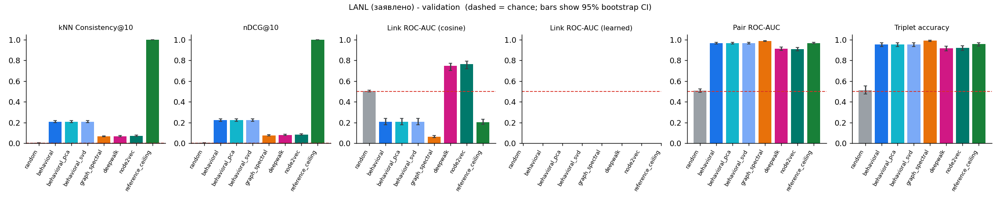
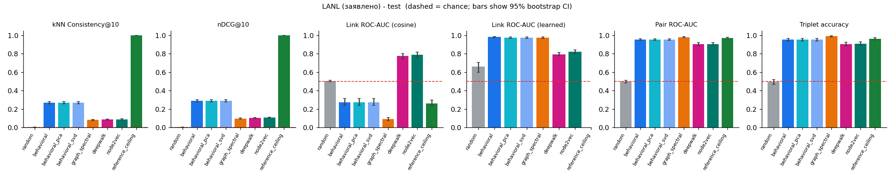
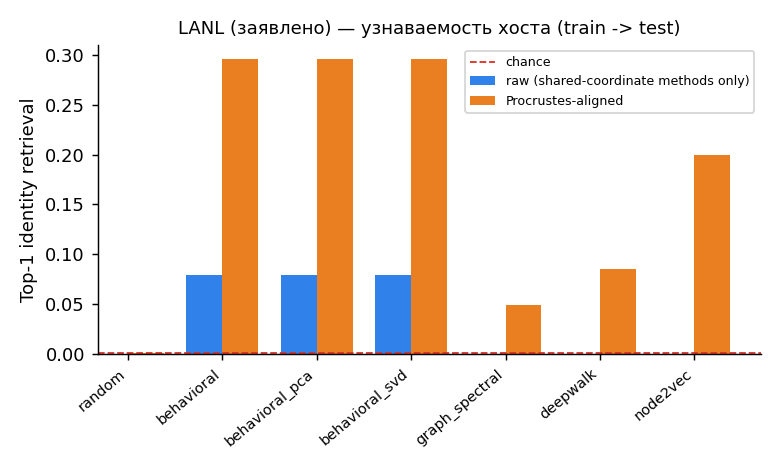
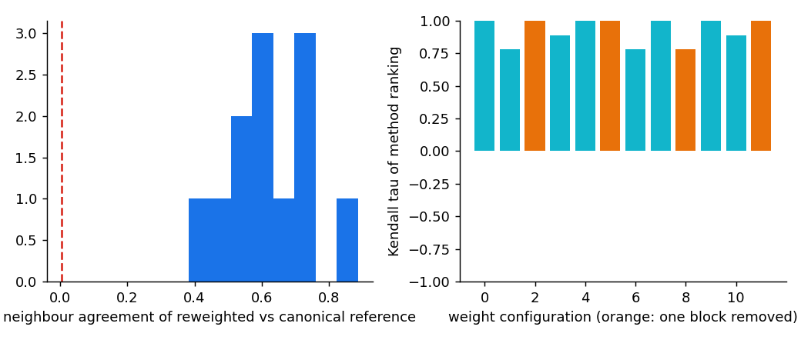

# Отчёт о прогоне

> **LANL (заявлено оператором; происхождение пайплайном не проверено).**
>
> Выводы относятся к заявленным файлам LANL NetFlow при протоколе из этого отчёта (окна, когорта, эталоны). Это не утверждения о других данных, других окнах или ролях хостов.

* источник, заявленный оператором: *LANL NetFlow day 02, downloaded 2026-10-26*. Пайплайн проверить это не может (`provenance_verified: false`).
* данные: `lanl_declared` (основание: operator_declaration); хостов в когорте: **6453**; dim=32, seed=0, bootstrap=200; окна оценки: validation, test
* оценены методы: behavioral, behavioral_pca, behavioral_svd, deepwalk, graph_spectral, node2vec, random, reference_ceiling
* **в этом прогоне нет** (эмбеддинги не переданы, ничего не симулируется): graphsage, struc2vec, rolx
* политика когорты `train_only`; оцениваемых хостов по окнам: validation: 2761/6453 (43%), test: 2242/6453 (35%)
  * Когорта определяется ТОЛЬКО по train-окну. Хост, неактивный в позднем окне, там не оценивается; каждый эталон строится по оцениваемым хостам, покрытие пишется в отчёт. «Выживание» хостов в поздние окна — часть измеряемого результата, а не определения когорты.

## Результаты — эталон validation

| method | consistency@10_mean | ndcg@10_mean | link_roc_auc | link_learned_roc_auc | link_new_roc_auc | partner_new_mrr | pair_roc_auc | triplet_accuracy | precision@3 | recall@3 |
|---|---|---|---|---|---|---|---|---|---|---|
| random | 0.004 | 0.003 | 0.503 | n/a | 0.502 | 0.084 | 0.506 | 0.512 | 0.531 | 0.435 |
| behavioral | 0.208 | 0.222 | 0.206 | n/a | 0.150 | 0.225 | 0.968 | 0.956 | 0.820 | 0.697 |
| behavioral_pca | 0.208 | 0.222 | 0.206 | n/a | 0.150 | 0.225 | 0.968 | 0.956 | 0.820 | 0.697 |
| behavioral_svd | 0.208 | 0.222 | 0.206 | n/a | 0.150 | 0.225 | 0.968 | 0.956 | 0.820 | 0.697 |
| graph_spectral | 0.065 | 0.074 | 0.061 | n/a | 0.061 | 0.186 | 0.987 | 0.991 | 0.846 | 0.721 |
| deepwalk | 0.067 | 0.080 | 0.749 | n/a | 0.704 | 0.226 | 0.913 | 0.918 | 0.798 | 0.679 |
| node2vec | 0.072 | 0.084 | 0.765 | n/a | 0.665 | 0.222 | 0.910 | 0.920 | 0.798 | 0.678 |
| reference_ceiling | 1.000 | 1.000 | 0.204 | n/a | 0.158 | 0.251 | 0.969 | 0.959 | 0.824 | 0.700 |

Точка отсчёта для связей без эмбеддинга — *пара уже общалась в source-окне*: ROC-AUC **0.946**. `link_learned_*` — классификатор рёбер, обученный на кандидатах validation и оценённый на test; косинус показан для полноты.

## Результаты — эталон test

| method | consistency@10_mean | ndcg@10_mean | link_roc_auc | link_learned_roc_auc | link_new_roc_auc | partner_new_mrr | pair_roc_auc | triplet_accuracy | precision@3 | recall@3 |
|---|---|---|---|---|---|---|---|---|---|---|
| random | 0.005 | 0.004 | 0.503 | 0.662 | 0.507 | 0.065 | 0.500 | 0.495 | 0.456 | 0.195 |
| behavioral | 0.269 | 0.290 | 0.272 | 0.983 | 0.204 | 0.204 | 0.954 | 0.954 | 0.869 | 0.468 |
| behavioral_pca | 0.269 | 0.290 | 0.272 | 0.977 | 0.204 | 0.204 | 0.954 | 0.954 | 0.869 | 0.468 |
| behavioral_svd | 0.269 | 0.290 | 0.272 | 0.977 | 0.204 | 0.204 | 0.954 | 0.954 | 0.869 | 0.468 |
| graph_spectral | 0.081 | 0.097 | 0.089 | 0.978 | 0.087 | 0.162 | 0.982 | 0.991 | 0.900 | 0.486 |
| deepwalk | 0.085 | 0.102 | 0.776 | 0.794 | 0.719 | 0.169 | 0.906 | 0.906 | 0.843 | 0.454 |
| node2vec | 0.088 | 0.105 | 0.791 | 0.822 | 0.688 | 0.181 | 0.906 | 0.911 | 0.852 | 0.460 |
| reference_ceiling | 1.000 | 1.000 | 0.260 | n/a | 0.211 | 0.230 | 0.973 | 0.965 | 0.876 | 0.470 |

Точка отсчёта для связей без эмбеддинга — *пара уже общалась в source-окне*: ROC-AUC **0.939**. `link_learned_*` — классификатор рёбер, обученный на кандидатах validation и оценённый на test; косинус показан для полноты.

## Недоступные метрики

* linear_probe: нет labels.csv (внешних меток хостов нет, придумывать их нельзя)
* link_learned: нет эталона validation или его хостов в эмбеддинге — классификатору не на чем учиться

## 95% бутстреп-интервалы (test)

| method | metric | estimate | ci_low | ci_high |
|---|---|---|---|---|
| random | consistency@10_mean | 0.005 | 0.004 | 0.006 |
| random | link_roc_auc | 0.503 | 0.494 | 0.511 |
| random | pair_roc_auc | 0.500 | 0.484 | 0.513 |
| random | triplet_accuracy | 0.495 | 0.466 | 0.520 |
| behavioral | consistency@10_mean | 0.269 | 0.258 | 0.281 |
| behavioral | link_roc_auc | 0.272 | 0.240 | 0.314 |
| behavioral | pair_roc_auc | 0.954 | 0.946 | 0.962 |
| behavioral | triplet_accuracy | 0.954 | 0.937 | 0.969 |
| behavioral_pca | consistency@10_mean | 0.269 | 0.258 | 0.281 |
| behavioral_pca | link_roc_auc | 0.272 | 0.240 | 0.314 |
| behavioral_pca | pair_roc_auc | 0.954 | 0.946 | 0.962 |
| behavioral_pca | triplet_accuracy | 0.954 | 0.937 | 0.969 |
| behavioral_svd | consistency@10_mean | 0.269 | 0.258 | 0.281 |
| behavioral_svd | link_roc_auc | 0.272 | 0.240 | 0.314 |
| behavioral_svd | pair_roc_auc | 0.954 | 0.946 | 0.962 |
| behavioral_svd | triplet_accuracy | 0.954 | 0.937 | 0.969 |
| graph_spectral | consistency@10_mean | 0.081 | 0.075 | 0.087 |
| graph_spectral | link_roc_auc | 0.089 | 0.075 | 0.106 |
| graph_spectral | pair_roc_auc | 0.982 | 0.974 | 0.988 |
| graph_spectral | triplet_accuracy | 0.991 | 0.983 | 0.996 |
| deepwalk | consistency@10_mean | 0.085 | 0.079 | 0.090 |
| deepwalk | link_roc_auc | 0.776 | 0.743 | 0.804 |
| deepwalk | pair_roc_auc | 0.906 | 0.887 | 0.921 |
| deepwalk | triplet_accuracy | 0.906 | 0.883 | 0.927 |
| node2vec | consistency@10_mean | 0.088 | 0.081 | 0.093 |
| node2vec | link_roc_auc | 0.791 | 0.757 | 0.819 |
| node2vec | pair_roc_auc | 0.906 | 0.888 | 0.920 |
| node2vec | triplet_accuracy | 0.911 | 0.893 | 0.932 |
| reference_ceiling | consistency@10_mean | 1.000 | 1.000 | 1.000 |
| reference_ceiling | link_roc_auc | 0.260 | 0.234 | 0.296 |
| reference_ceiling | pair_roc_auc | 0.973 | 0.966 | 0.979 |
| reference_ceiling | triplet_accuracy | 0.965 | 0.950 | 0.977 |

## Узнаваемость хоста во времени (train -> test)

| method | общие координаты заявлены | Top-1 сырые | Top-1 Procrustes | MRR Procrustes | ROC-AUC пар Procrustes | случайный Top-1 |
|---|---|---|---|---|---|---|
| random | False | 0.002 | 0.002 | 0.008 | 0.508 | 0.001 |
| behavioral | True | 0.079 | 0.295 | 0.371 | 0.912 | 0.001 |
| behavioral_pca | True | 0.079 | 0.295 | 0.371 | 0.912 | 0.001 |
| behavioral_svd | True | 0.079 | 0.295 | 0.371 | 0.912 | 0.001 |
| graph_spectral | False | 0.000 | 0.049 | 0.096 | 0.788 | 0.001 |
| deepwalk | False | 0.001 | 0.086 | 0.166 | 0.877 | 0.001 |
| node2vec | False | 0.002 | 0.200 | 0.292 | 0.910 | 0.001 |

Сырые координаты осмысленны только для методов, заявивших общую систему координат.

## Аудит валидности

* **Чувствительность к весам** (12 изменённых поведенческих эталонов, k=10): совпадение соседей с основным эталоном в среднем 0.62 (минимум 0.38; случайно 0.004); тау Кендалла порядка методов в среднем 0.93, минимум 0.78.
* **Стабильность эталона** train->validation: Consistency@10 = 0.31 (случайно 0.007) — поведенческое соседство дрейфует между окнами.
* **Стабильность эталона** train->test: Consistency@10 = 0.32 (случайно 0.007) — поведенческое соседство дрейфует между окнами.
* **Стабильность эталона** validation->test: Consistency@10 = 0.32 (случайно 0.007) — поведенческое соседство дрейфует между окнами.
* **Согласие порядка validation и test** (тау Кендалла): consistency@10_mean: 1.00, link_roc_auc: 1.00, pair_roc_auc: 1.00, triplet_accuracy: 1.00
* **Случайный уровень (случайные эмбеддинги, test)**: consistency@10_mean 0.004 ± 0.001, link_roc_auc 0.500 ± 0.002, link_learned_roc_auc 0.679 ± 0.016, pair_roc_auc 0.501 ± 0.005, triplet_accuracy 0.502 ± 0.007
* **Доля связей среди кандидатов**: в выборке 0.50, на самом деле 0.009; 88% будущих связей уже были в source-окне (см. ROC-AUC только новых связей).

### Что метод делит с эталоном по построению

| method | neighbors | edges | pairs |
|---|---|---|---|
| random | none | none | none |
| behavioral | same feature definitions, earlier window (feature overlap) | none | weak: behaviour correlates with peers |
| behavioral_pca | same feature definitions, earlier window (feature overlap) | none | weak: behaviour correlates with peers |
| behavioral_svd | same feature definitions, earlier window (feature overlap) | none | weak: behaviour correlates with peers |
| behavioral_portfree | same feature definitions MINUS the port block, earlier window (reduced feature overlap) | none | weak: behaviour correlates with peers |
| behavioral_portfree_pca | same feature definitions MINUS the port block, earlier window (reduced feature overlap) | none | weak: behaviour correlates with peers |
| graph_spectral | weak: degree/volume leaks into the spectrum | strong: link persistence (peers seen in train recur) | strong: peer sets persist across windows |
| reference_ceiling | identical by construction (target-window features) | none | weak |
| deepwalk | weak: peers/degree structure correlates with behaviour | strong: link persistence (peers seen in train recur) | strong: shared peers = shared neighbourhood |
| node2vec | weak: peers/degree structure correlates with behaviour | strong: link persistence (peers seen in train recur) | strong: shared peers = shared neighbourhood |

## Как читать эти числа

* **Прогноз:** будущие связи (результат виден позже) и узнаваемость. **Согласие с выбранным нами приближением:** kNN (поведенческий профиль), пары/тройки/P@k (общие собеседники).
* `reference_ceiling` — признаки самого целевого окна, «утекает» намеренно; бейзлайны делят с эталонами признаки или структуру собеседников (таблица выше), поэтому это точки калибровки, а не независимое доказательство.
* Интервалы: для kNN и Precision@k пересэмплируются хосты; для связей, пар и троек — бутстреп по хостам (пары делят хостов). Они описывают только выбор оцениваемых элементов, а не seed модели, эталон или окна.
* Результаты верны только для заявленных файлов; какие хосты они описывают, решает политика когорты (см. выше).
